  

  
  
  

  

## Featured projects

  

  

  

  

**Working with** Java, JavaScript, TypeScript, React, Node.js, Express, MongoDB and PostgreSQL.

**Outside code** I play guitar. [Email me](mailto:rudranilkesh6@gmail.com) · [Kaggle](https://www.kaggle.com/rudranilkesh) · [Instagram](https://www.instagram.com/rudranilkesh_6)
